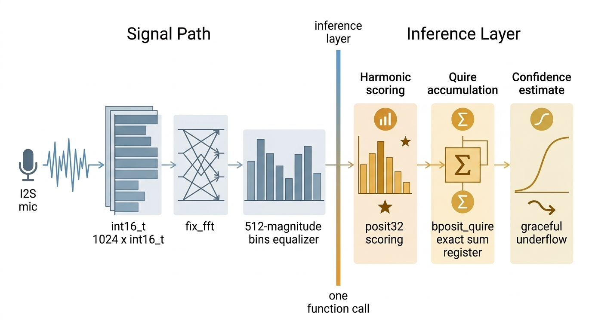

# fe310 — Bare-Metal HAL for SiFive FE310 / LoFive R1

Integer arithmetic. No FPU. No OS. No HAL framework. No CMSIS.  
One flat directory. Each app is one `.c` file and one `.mk` file.  
Everything compiles with a single `make -f <app>.mk`.

---

## Philosophy

No layers. No abstraction tax. The register is the API.  
Platform files are small, single-purpose, and independently readable.  
Apps wire platform files together — no hidden glue, no magic linker scripts beyond the two provided.  
Posit arithmetic headers symlink from `rv32i-asm` — one source of truth, two branches.

---

## Platform Files

| File | What it does |
|------|-------------|
| `start.s` | Bootstrap: stack, PMP, mtvec → `clint_trap_handler`, calls `main` |
| `pmu.s` / `pmu.e` | PMU trap handler, RTC init, RTC sweep (exp + linear) |
| `prci.s` / `prci.e` | Full PRCI FSM in assembly — HFROSC, HFXOSC, PLL, all transitions |
| `gpio.c` / `gpio.h` | GPIO driver — dir, IOF, pull, drive, XOR |
| `gpio.e` | GPIO register offsets + FE310 48QFN pin map (for assembly) |
| `spi1.c` / `spi1.h` | SPI1 driver — init, transfer, block transfer; EXTRADEL/SAMPLEDEL for noisy boards |
| `oled.c` / `oled.h` | SSD1306 128×64 OLED — text, lines, circles, plot points |
| `math.c` | Integer math: clz, sqrt (Newton), bradians, sin/cos (Coranac/Steadman), atan2, mul |
| `util.c` / `util.h` | tostr, strlen, strcpy, strcat, itoa |
| `fixfft.c` / `fixfft.h` | Fixed-point FFT (FIX_MPY, fix_fft, fix_fftr) — no main, no I2S, no PWM |
| `sinetab.h` | N_WAVE=256, 64-entry SINTAB_16 (int32_t), sintab()/costab() with quadrant unfolding |
| `i2s.c` / `i2s.h` | GPIO bit-bang I2S mic driver (INMP441-compatible): i2s_init, i2s_read_sync |
| `pwm.c` / `pwm.h` | PWM1/PWM2 clock generation for I2S BCLK/LRCLK — 7 rates 300–4800 kHz at 64 MHz |
| `timer.c` / `timer.h` | CLINT/PLIC trap dispatch, vectored handler tables, timer_init |
| `csr.e` | MSTATUS, MIE, MIP, MCAUSE CSR bit defs (for assembly) |
| `pcba-lofive-r1.e` | LoFive R1 board pin-to-GPIO mapping (for assembly) |
| `fe310-g002-ram.lds` | Linker script — RAM: 0x80000000, 16 KB on-chip SRAM |
| `fe310-g002-rom.lds` | Linker script — ROM: 0x20000000, 16 MB flash |
| `defs.h` | Bit-field helpers: mask, reg, set, get |
| `jcsse.mk` | Toolchain + Olimex JTAG config (riscv64-unknown-elf, Windows/Linux) |

---

## Posit Arithmetic Headers (from rv32i-asm)

These headers live in `rv32i-asm` and are symlinked here.  
One source of truth — edits on `rv32i-asm` are immediately visible in `fe310`.

| Symlink | What it covers |
|---------|---------------|
| `quire32.h` | 64-bit quire accumulator, all-integer posit32 |
| `bposit_quire.h` | B-posit quire — full accumulate/round |
| `bposit_quire_double.h` | B-posit quire, double-precision extension |
| `posit_trig56.h` | Posit trig to 56-bit accuracy (sin_pi, cos_pi) |

---

## Apps

|       App         |             File                 | What it does |
|-------------------|----------------------------------|--------------|
| posit_hello       | `posit_hello.c`                  | posit4 hello world — all 16 values, quire demo, no libraries |
| posit_hello (asm) | `posit_hello_rv32i.s`            | same in pure RV32I assembly — quire is 3 ADDs |
| FFT demo          | `fft_demo.c` / `fft_demo.mk`     | I2S mic → FFT → OLED spectrum display |
| Pitch             | `pitch.c` / `pitch.mk`           | Guitar string tuner from chord (I2S → FFT → harmonic analysis) |
| Flicker           | `flicker.c` / `flicker.mk`       | LED flicker meter / IEEE 1789 compliance (photodiode → FFT → classify) |
| Bandleader        | `bandleader.c` / `bandleader.mk` | Ensemble sync/tuning detector |
| Wumpus            | `wumpus.c` / `wumpus.mk`         | Hunt the Wumpus — posit policy network |
| Maze              | `maze.c` / `maze.mk`             | Robot maze solver — posit micro-AI |
| Stego             | `stego.c` / `stego.mk`           | Neural steganography — hide a message in image or audio |

---

## Building

```sh
# toolchain (adjust path for your machine)
export PATH=/home/wilson/build/gcc-riscv/gcc-riscv64-unknown-elf/bin:$PATH

# build for on-chip SRAM (JTAG load)
make -f fft_demo.mk fft_demo-ram.elf

# build for flash
make -f fft_demo.mk fft_demo-rom.elf
```

**Note:** binutils 2.38+ requires `-march=rv32imac_zicsr` for CSR instructions.  
Older toolchains (Surface, Thailand lab): use `-march=rv32imac` — the old lines are  
kept as comments in each `.mk` file.

---

## Flashing (Olimex JTAG)

```sh
# via jcsse.mk (OpenOCD + Olimex ARM-USB-OCD-H)
make -f jcsse.mk flash PGM=fft_demo
```

---

## LoFive R1 I2S Pin Assignments

| Signal | GPIO | LoFive Pin | Function |
|--------|------|-----------|---------|
| STAT | 9 | 15 | activity pulse (debug) |
| LRCLK / WS | 19 | 23 | PWM1.1 word select |
| BCLK | 11 | 17 | PWM2.1 bit clock |
| DOUT | 21 | 25 | mic data in |

HFCLK = 64 MHz (16 MHz xtal through PLL, `clock_init_xdir()`).  
BCLK rates: 300 / 1000 / 1340 / 2000 / 3000 / 4000 / 4800 kHz.

---

*Tested on LoFive R1 (SiFive FE310-G002). All integer. No FPU. No OS.*

---

## When to Use Posit Arithmetic (and When Not To)



> **Fixed-point for the signal path. Posit for the inference layer.**

### When NOT to use posit

* **FFT butterflies:** Fixed-point (`int16_t`) wins every time. Known dynamic range, uniform precision across bins, single-cycle hardware integer multiplies. See `fft_demo.c`.
* **Deterministic inner loops:** Anywhere you know your value bounds cold and require strictly predictable cycle counts.
* **Signal acquisition:** Your ADC hands you integers — keep them integers.

### When posit earns its place

* **Scoring and ranking:** Harmonic confidence, pitch likelihood, probabilistic weights — you need graceful underflow in the tails, not a flush-to-zero cliff.
* **Multi-frame accumulation:** A posit quire (`bposit_quire`) is an exact accumulator. Rounding drift across long integration windows simply does not exist.
* **Physics-adjacent math:** Sigmoids, `erfc`, Chauvenet's criterion — functions that live near zero and near one simultaneously, where tapered precision matters.
* **32-bit targets, 64-bit accuracy:** Posit32 matches double-precision float in the regime near 1.0 — without the FPU, without promoting to 64 bits.

For the full treatment with signal-path examples from this codebase, see
[When to Use Posit Arithmetic — and When Not To](https://lab.riscvthai.org/posits/when-to-use-posit.html).
